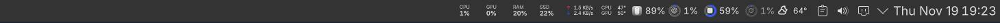

<div align="center">

# Widgets

KDE Plasma 6 panel widgets, plus a script that arranges them into a macOS-style menu bar.

[](https://github.com/NicL9923/widgets/actions/workflows/ci.yml)
[](LICENSE)
[](https://kde.org/plasma-desktop/)



</div>

| Widget | What it shows |
| --- | --- |
| [System Stats](system-stats/) | A port of [Stats](https://github.com/exelban/stats) for macOS: CPU, GPU, memory, disk, network, and sensor readings, one panel item per module, each with its own popup of charts, details, and top processes. |
| [Device Battery](device-battery/) | Battery levels of wireless headsets, mice, and Bluetooth devices while they are connected. |
| [AI Usage](ai-usage/) | Claude Code, Codex, and Grok subscription usage. Also available as a macOS menu bar app. |

Each folder has its own README and `scripts/install.sh`. Clone once, then install the ones
you want:

```bash
git clone https://github.com/NicL9923/widgets.git
cd widgets
./system-stats/scripts/install.sh
./device-battery/scripts/install.sh
./ai-usage/scripts/install.sh
```

[`desktop/macos-look`](desktop/macos-look/) installs the MacTahoe theme parts and builds a
menu bar with all three widgets on every screen, plus a dock. It snapshots your current
setup first and comes with a restore script.
