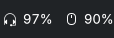
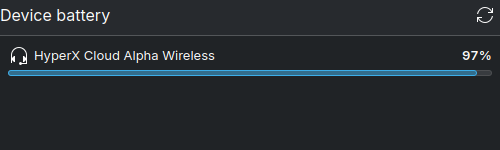

# Device Battery

Battery levels for wireless headsets, mice, and Bluetooth devices in the Plasma panel.
Devices show up when they connect and leave when they disconnect. A mouse that goes to
sleep stays listed, faded, with its last reading.





| Source | Devices | Notes |
| --- | --- | --- |
| [HeadsetControl](https://github.com/Sapd/HeadsetControl) | Wireless gaming headsets on a USB dongle, such as the HyperX Cloud Alpha Wireless | Fedora: `sudo dnf install headsetcontrol`. The package's udev rules grant access. |
| Razer HID protocol | Razer wireless mice, verified on the Viper V3 Pro dongle (`1532:00c1`) | Reads the same 90-byte feature report as OpenRazer, from userspace over hidraw. No kernel module. |
| UPower | Bluetooth devices that report a battery, Logitech receivers, and other kernel-exposed peripheral batteries | Apple headphones report only while connected over the HFP profile, through PipeWire. |

A headset that is off reports "unavailable" through its dongle and is left out. A sleeping
Razer mouse makes its dongle answer "timeout"; the widget keeps showing the last real
reading with its age, cached in `~/.cache/device-battery/`. Nothing is ever shown as 0%
without a reading.

## Install

```bash
./scripts/install.sh
```

The installer copies the helper to `~/.local/share/device-battery-widget` with a
`~/.local/bin/device-battery` launcher, installs the Razer udev rule (it asks for sudo),
and installs the applet. Add **Device Battery** from the panel's **Add widgets**. With
nothing connected it takes no panel space.

```bash
device-battery          # JSON for scripts and status bars
device-battery --plain  # human-readable output
```

## Add a Razer mouse

Only dongles checked against OpenRazer's driver tables are queried. To add one, find its
transaction id in `openrazer/driver/razermouse_driver.c`, add the product id to `MODELS` in
`src/device_battery/razer.py`, and add the same id to `udev/70-device-battery.rules`.

## Development

From the repository root:

```bash
.venv/bin/pip install -e './device-battery[dev]'
(cd device-battery && ../.venv/bin/python -m pytest)
node --test device-battery/tests/test_ui.cjs
```
