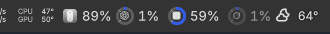
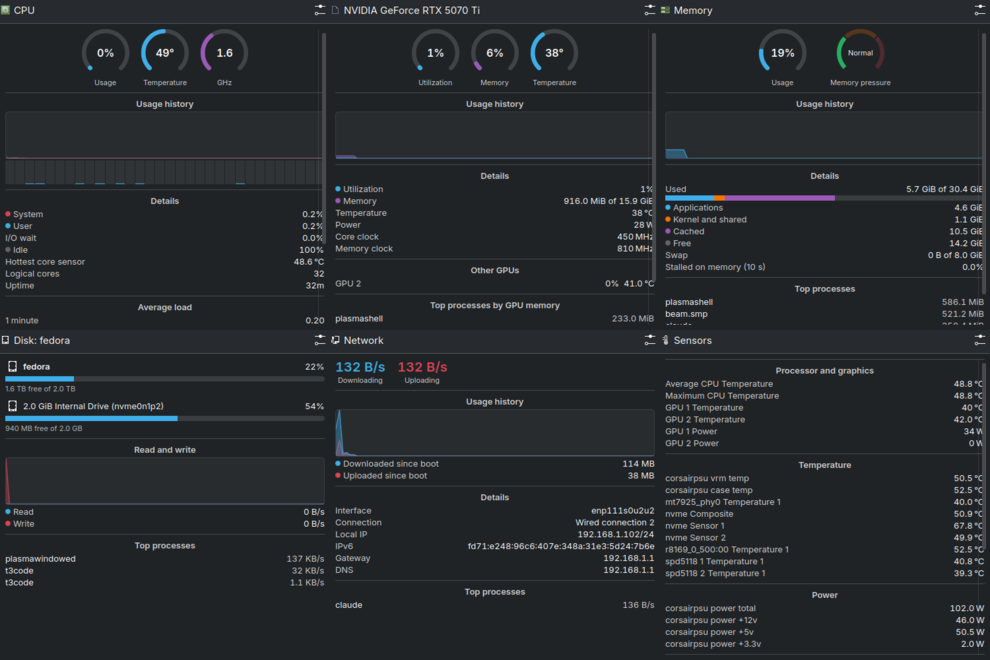

# System Stats

A Plasma 6 port of [Stats](https://github.com/exelban/stats), the macOS menu bar system
monitor. Each widget instance shows one module, the way each Stats item does. Add six
instances for the full set.





| Module | Panel default | Popup |
| --- | --- | --- |
| CPU | Mini | Usage, temperature, and frequency gauges; system and user history; per-core bars; load averages; top processes |
| GPU | Mini | Utilization, memory, and temperature gauges; history; power and clocks; other GPUs; top processes by GPU memory |
| Memory | Mini | Usage and pressure gauges; history; applications, kernel and shared, cached, and free; swap; top processes |
| Disk | Mini | Every filesystem's usage; read and write history; top processes by I/O |
| Network | Speed | Download and upload; history; totals since boot; interface, addresses, gateway, DNS; top processes |
| Sensors | Stack | Every hardware sensor ksystemstats reports, grouped into temperature, power, fans, voltage, and current |

Panel styles are mini, line chart, bar chart (per-core for CPU), speed, and stack. Colors
follow the Plasma theme. Utilization turns the warning color at 60% and the critical color
at 80%, like Stats. Temperatures turn at 80 °C and 90 °C. Memory pressure uses Linux PSI:
warning once tasks stall on memory 10% of the time over 10 seconds, critical at 40%.

Stats has a few modules this port does not: Battery, which Plasma's own battery widget
covers; Bluetooth, which [Device Battery](../device-battery/) covers; and Clock. It also
skips the public IP lookup, so the widget never makes network requests.

## Install

```bash
./scripts/install.sh
```

Then right-click the panel, choose **Add widgets**, add **System Stats**, and pick its
module in the widget's settings. Repeat for each module.

## How it reads data

Everything comes from KDE's `ksystemstats` daemon through the `org.kde.ksysguard.sensors`
and `org.kde.ksysguard.process` QML modules, the same source as Plasma System Monitor.
There is no helper process. History charts record in the background, so they are already
full when you open a popup. The per-process model and per-core sensors only run while a
popup or the bar style shows them.

## Development

```bash
node --test tests/test_logic.cjs
../.agents/tools/plasma-capture.sh plasmoid /tmp/cpu.png full
PLASMA_CAPTURE_CONFIG="module=network" ../.agents/tools/plasma-capture.sh plasmoid /tmp/net.png horizontal
```
